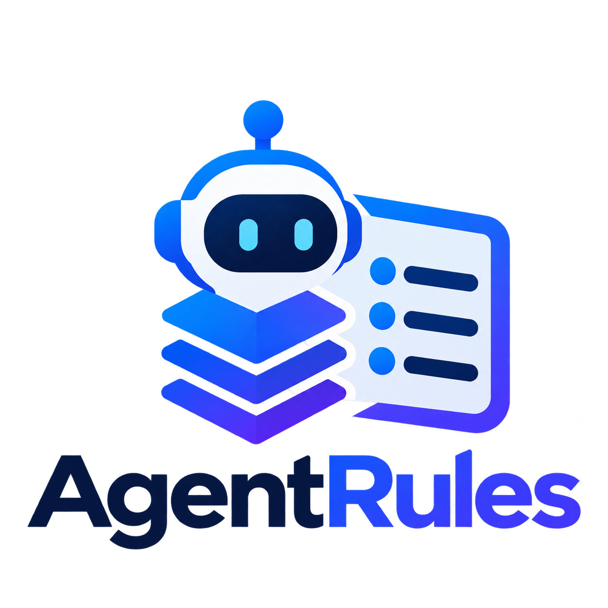

[简体中文](README.md) · English

<div align="center">
  
  <p><strong>Quickly create a tailored AGENTS.md for your project.</strong></p>
  <p>Reusable Rules. Project-Specific Instructions.</p>

  <p>
    <a href="VERSION"></a>
    <a href="LICENSE"></a>
  </p>
  <p><a href="#quick-start">Quick Start</a> · <a href="#use-cases">Use Cases</a> · <a href="#how-it-works">How It Works</a> · <a href="#customize">Refine Rules</a></p>
</div>

---

AgentRules combines reusable behavior rules with your project's existing materials and requirements to generate a ready-to-use `AGENTS.md`. It covers software development, documentation, academic papers, project proposals, and personal knowledge bases.

**Turn recurring requests into project instructions, instead of rewriting the same prompts for every task.**

<a id="quick-start"></a>

## Quick Start

### 1 · Ask your agent to install

In an agent session with network access and local file permissions, copy and send:

```text
Install AgentRules for this agent:
https://github.com/QuantumHW/AgentRules

Keep the complete repository in a persistent local directory.
Preserve the relative layout of skills/generate-agents, rules/, and profiles/.
Do not copy only SKILL.md or overwrite an existing installation.

If Agent Skills are supported, register generate-agents using this tool's mechanism.
Otherwise, provide the local SKILL.md path and how to invoke it by reading it directly.
Check that the entry point and rule resources are readable.
Report the installation location and actual check results.
```

The agent handles downloading, configuration, and checks; you do not need to run commands manually. Keep the complete repository in place so resource references remain valid.

### 2 · Generate instructions in your project

Open your project, provide any existing README, requirements, code, templates, or notes, and send:

```text
Use AgentRules to analyze this project
and generate a suitable AGENTS.md.
```

Review the project facts, scope, and verification requirements before using the file for subsequent tasks. With limited information, the workflow produces supported baseline instructions rather than inventing a technology stack or commands.

### 3 · Refine in natural language

```text
Use AgentRules to update the current AGENTS.md.
Preserve handwritten commands and valid project constraints, and merge this request:
This is a research prototype with no legacy compatibility requirements.
Simplify those constraints while keeping necessary correctness and security rules.
```

> **Already have AGENTS.md?** A generation request produces a candidate or diff without overwriting it. Explicit update requests authorize merging; substantive conflicts that cannot be resolved safely require your decision.

<details>
<summary>Codex installation and invocation example</summary>

Codex can discover a symlink from `~/.agents/skills/generate-agents` to the repository's `skills/generate-agents` directory. It also supports explicit invocation:

```text
$generate-agents Generate AGENTS.md for this project based on its existing materials.
```

See the [official OpenAI Skill documentation](https://learn.chatgpt.com/docs/build-skills) for loading details. Other agents use their own mechanisms. Without automatic Skill discovery, include the local `SKILL.md` path returned during installation and ask the agent to read and follow it.

</details>

<a id="use-cases"></a>

## Use Cases

| Your work | Main focus |
| --- | --- |
| **Software development** | Appropriate design, error handling, scope control, code verification |
| **General documentation** | Accurate content, concise writing, consistent structure and terminology |
| **Academic papers** | Verifiable references, authentic experimental data, supported conclusions |
| **Project proposals** | Template and layout preservation, source verification, aligned tasks, metrics, and outcomes |
| **Personal notes and knowledge bases** | Deduplication and links, properties and tags, archiving and recoverable deletion |

A project can combine multiple contexts. Code, a paper, and a guide can have separate requirements while sharing common constraints.

<details>
<summary>Copy a request for your context</summary>

**Software development**

> Use AgentRules to generate AGENTS.md for this project. Focus on avoiding overengineering, unnecessary exception handling, and feature expansion beyond the requirements.

**General documentation**

> Use AgentRules to generate AGENTS.md for this documentation project. Preserve existing structure and writing style, use consistent terminology, require evidence for technical metrics, and remove process narration that adds no information.

**Academic papers**

> Use AgentRules to generate AGENTS.md for this paper project. Require verifiable data and citations, consistency between results and conclusions, and precise, concise writing that retains necessary conditions and limitations.

**Project proposals**

> Use AgentRules to generate AGENTS.md for this proposal project. Follow the existing template and supporting materials, do not invent research outcomes or technical targets, and keep research tasks aligned with assessment targets.

**Personal notes and knowledge bases**

> Use AgentRules to generate AGENTS.md for this knowledge base. Preserve existing viewpoints and technical details, avoid duplicate notes, follow property, tag, and link conventions, distinguish formal notes from working records, and define authorization boundaries for bulk organization and recoverable deletion.

Knowledge-base fields, heading levels, and paths come from actual project conventions. For a mixed project, add: “Cover the source code, paper, and user guide, distinguishing their scopes.”

</details>

Example outputs: [software project](examples/software/AGENTS.md) · [project proposal](examples/proposal/AGENTS.md) · [personal knowledge base](examples/knowledge-base/AGENTS.md). These use fictional demonstration settings, not your project's configuration.

<a id="how-it-works"></a>

## How It Works

1. **Analyze the project**: Read relevant descriptions, configuration, existing instructions, and task materials to establish the actual context.
2. **Combine rules**: Select behavior Rules and context Profiles, resolving duplication, conflicts, and irrelevant constraints.
3. **Generate instructions**: The `generate-agents` Skill organizes a project-specific `AGENTS.md` and checks facts, scope, and consistency.

The instructions address recurring problems:

- **Overengineering and unjustified defensive code**: Avoid abstractions, compatibility layers, and repeated checks for hypothetical needs; retain handling required at real error boundaries.
- **Fabrication and redundancy**: Do not invent capabilities, data, or references, or present assumptions as facts. Remove empty boilerplate and self-justification.
- **Editing history inside deliverables**: Keep official names and current content, without adding labels such as “simplified edition” or statements announcing deletions.
- **Scope creep**: Preserve valid project instructions and user changes instead of rewriting unrelated content during a task.

The output guides later work; generating it does not itself develop software, edit proposals, or organize real notes. Confirmed product categories, user-specified names, capability limits, and explicitly requested historical materials retain their intended roles.

<a id="customize"></a>

## Refine Your Rules

**For requirements specific to one project**, ask your agent to update that project's `AGENTS.md`.

**For preferences you want to reuse**, open your local AgentRules repository and ask:

```text
Refine the general documentation rules:
When editing an existing document, preserve its structure and writing style.
Do not restructure the whole document unless the user explicitly requests it.
Check existing rules first and decide whether to merge, revise, or add a rule.
Maintain relevant Profile references and avoid duplication.
```

This changes your local rule library. It does not publish upstream or update existing project instructions automatically. To apply new rules, explicitly request a merged update to the target project's `AGENTS.md`.

You can also supply instructions from an earlier project as source material:

```text
Read this earlier project's AGENTS.md and integrate reusable requirements into AgentRules.
Compare existing Rules and Profiles, merge overlapping content, and maintain references.
Separate general behaviors, template requirements, and project-specific choices.
Do not turn its section numbers, organizations, metric values, duration, or paths
into universal constraints.
```

Proposal work can select [template and layout preservation](rules/template-preservation.md) and [research validation](rules/research-validation.md) as needed, with the [proposal Profile](profiles/proposal.md) organizing section responsibilities and delivery checks.

**This project's version** is defined in `VERSION`. Rules, Profiles, and Skills are product content: corrections that preserve existing usage increment PATCH; new rules, contexts, or generation capabilities increment MINOR; changes that break existing usage require a MAJOR assessment. Product maintenance includes synchronizing the version and both README badges. Continued work toward the same target version does not increment it again; auxiliary explanations and formatting alone do not trigger an increment. Updating a version and publishing it are separate actions.

## Usage Notes

- **Review before use**: Instructions provide ongoing guidance; adherence depends on the agent and is not guaranteed.
- **Use project evidence**: Do not invent unknown facts or remove necessary security checks, technical conditions, or factual qualifications for brevity.
- **Follow the tool's loading mechanism**: Rules target agents that support `AGENTS.md`. Skill discovery, invocation, and instruction precedence depend on the tool and require separate platform verification.

## License

AgentRules is available under the [MIT License](LICENSE).
